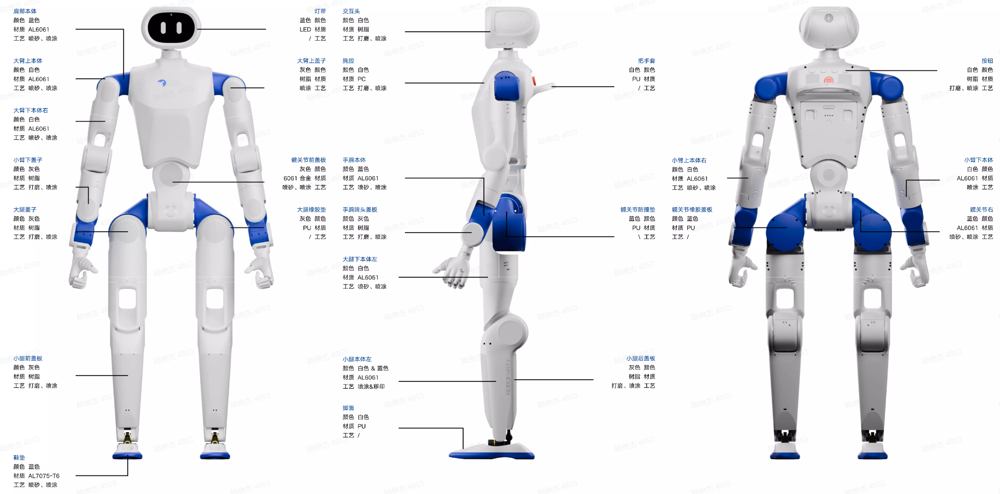
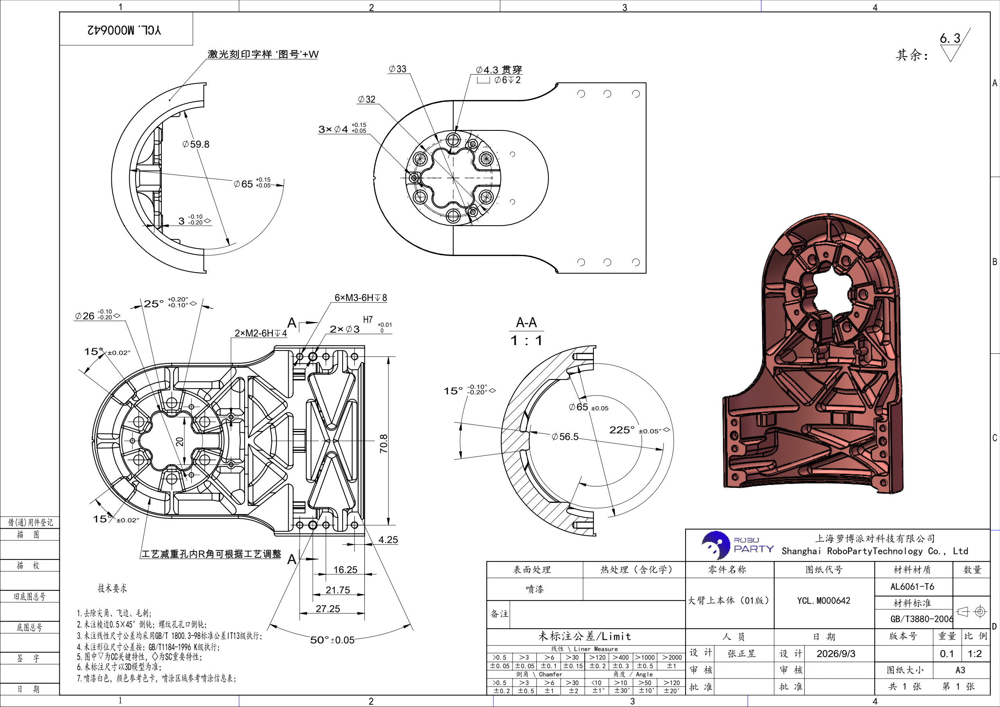
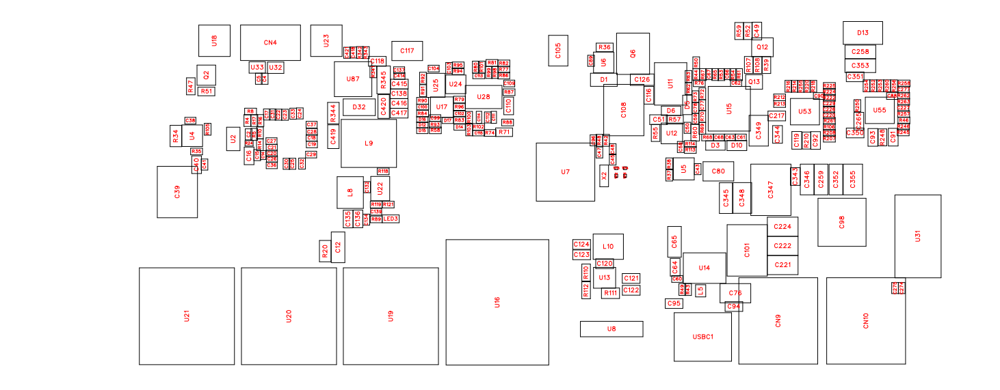
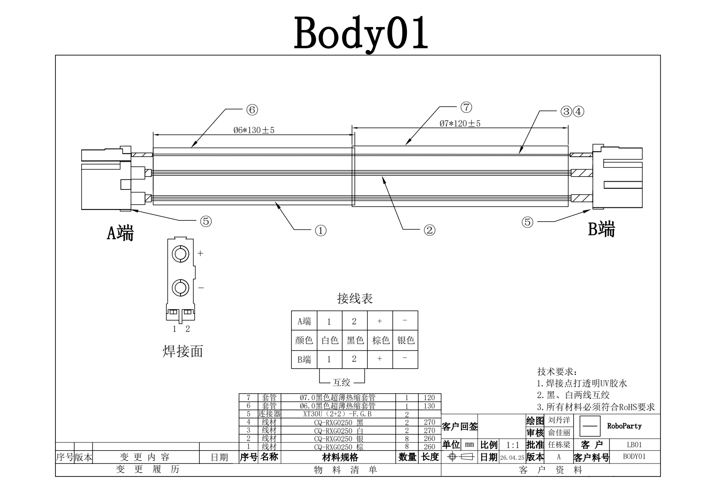

# RP1 硬件

[English](README.md) | 简体中文

RoboParty RP1 人形机器人的硬件设计与制造资料，包括机械结构、PCB 生产文件、线束图纸和物料清单。

## 项目资料

[硬件系统架构（PDF）](00_Docs/RP1_Hardware_Architecture.pdf)

| 资料 | 内容 |
| --- | --- |
| [机械结构](01_Mechanic/README.md) | SolidWorks 源文件、可编辑工程图、Parasolid 整机模型及制造文件 |
| [PCB](02_PCB/README.md) | 板级 BOM、Gerber、贴装坐标、3D 模型与加工要求 |
| [线束](03_Harness/README.md) | 线束 BOM、加工图纸与制作规范 |
| [整机 BOM](04_BOM/README.md) | 各配置的物料料号与数量 |

### 整机配置

| 配置 | BOM |
| --- | --- |
| 5DOF + 运控头 | [RP1_BOM_5DOF_MotionHead.xlsx](04_BOM/RP1_BOM_5DOF_MotionHead.xlsx) |
| 7DOF + 运控头 | [RP1_BOM_7DOF_MotionHead.xlsx](04_BOM/RP1_BOM_7DOF_MotionHead.xlsx) |

## CAD 下载

| 文件包 | 内容 |
| --- | --- |
| [RP1_SolidWorks_Source.zip](https://github.com/Roboparty/rp1_hardware/releases/download/v0.1.0/RP1_SolidWorks_Source.zip) | SolidWorks 装配体与零件源文件 |
| [RP1_Parasolid_Model.zip](https://github.com/Roboparty/rp1_hardware/releases/download/v0.1.0/RP1_Parasolid_Model.zip) | Parasolid 整机模型（.x_t） |
| [RP1_Drawings.zip](https://github.com/Roboparty/rp1_hardware/releases/download/v0.1.0/RP1_Drawings.zip) | 可编辑 SolidWorks 工程图（.SLDDRW） |

完整解压源文件包，从 `RP1_SolidWorks_Source/RP1.3.4整机.SLDASM` 打开整机。编辑工程图时，将 `RP1_Drawings` 内的 `.SLDDRW` 文件放到对应源模型所在目录。

## 图纸预览

### CNC 加工图纸 · 大臂上本体

[查看 CNC 加工图纸 PDF](<01_Mechanic/02_Manufacturing/01_CNC/Common/YCL.M000642 大臂上本体（01版）.PDF>)

### BACKHUB PCB 板图

[查看板图 PDF](02_PCB/12_RBE_PWR_BACKHUB/06_PCB_PDF_BACKHUB_V2.1.pdf)

### BODY01 线束图纸

[查看线束图纸 PDF](03_Harness/Drawings/RP1-BODY01-0线材.pdf)

## 参与贡献

发现文件错误或有设计改进建议，欢迎提交 [Issue](https://github.com/Roboparty/rp1_hardware/issues)，注明料号或板卡修订，以及对应的文件路径。

## 开源协议

RoboParty 自有硬件设计采用 [CERN-OHL-W-2.0](LICENSE)，说明文档采用 [CC BY-SA 4.0](https://creativecommons.org/licenses/by-sa/4.0/)。第三方文件保留原有许可条款，具体适用范围见 [LICENSES.md](LICENSES.md)。
